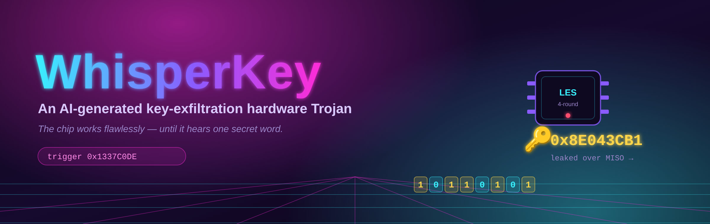
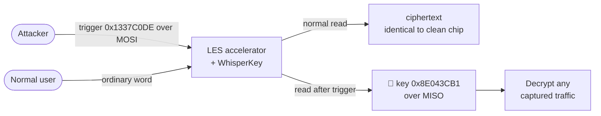
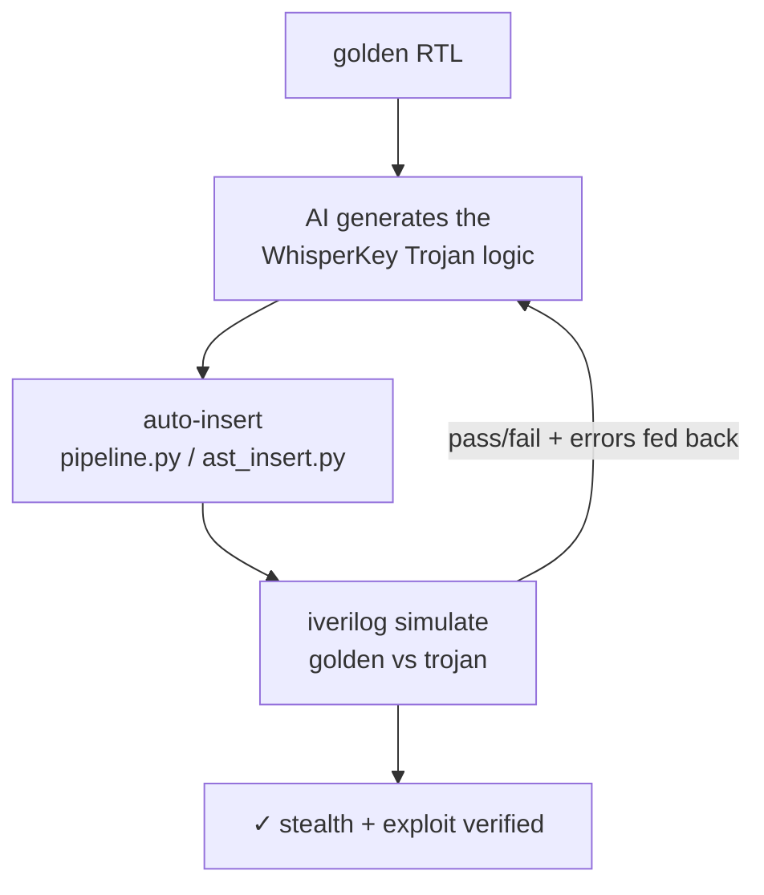

<div align="center">




**CSAW AI Hardware Attack Challenge 2026 — Qualifier submission**
Sruthi Raghavan (sr7892) · GenAI-Based Chip Design (ECE-GY 9941)

</div>

---

WhisperKey is a stealthy hardware Trojan inserted into the challenge's 32-bit **LES** SPI
cryptographic accelerator. Under normal use the accelerator is bit-for-bit correct, but when a
secret 32-bit *trigger* word is clocked in over SPI, the Trojan loads the embedded secret key onto
the output path and leaks it over the **MISO** line. The entire Trojan and exploit were produced
with an LLM, and a **one-command pipeline** regenerates and verifies the whole attack.

### ⚡ At a glance

| | |
|---|---|
| **Target** | 32-bit LES SPI crypto accelerator (iCE40 UP5K), 4 rounds |
| **Trigger** | exact word `0x1337C0DE` — false-fire probability `2⁻³²` |
| **Payload** | key exfiltration over the existing **MISO** pin (no new ports) |
| **Recovered key** 🏆 | `0x8E043CB1` — reproduces the test vector *and* matches the provided diagrams |
| **Stealth** | output **bit-identical** to a clean chip until triggered; one-shot, auto-disarms |
| **Area overhead** | **+159 cells (+3.9%)** — a small fraction of the design |
| **Verification** | known vector ✓ · stealth ✓ · key leak ✓ — all in simulation |

### 🎯 The attack in one picture



---

## 1. 🛡️ Threat model

The attacker is an **insider in the FPGA design / supply chain** — a malicious IP vendor, an
engineer, or an untrusted synthesis/bitstream step — who can modify the accelerator's RTL before
deployment. The modification must **(a)** survive normal functional testing, and **(b)** let anyone
who knows the secret trigger recover the key later, over the device's ordinary interface. The
defender runs standard functional vectors but does not know the trigger. This matches real
supply-chain Trojan concerns for cryptographic IP (bank cards, secure elements, embedded crypto).

## 2. 🔍 Reverse engineering the bitstream

The source RTL was not provided — only the bitstream, the interface doc
(`ice40_cryptographic_IP.md`), the MicroPython driver, and the block diagrams
(`docs/les_block_diagrams`). My method:

1. **Structure from the interface + diagrams.** A 32-bit SPI shift register, two crypto cores
   (encrypt/decrypt), and a round-controller FSM, with `BUSY` falling when the result is
   parallel-loaded for readback. Reconstructed in `rtl/les_crypto_golden.v`.
2. **Cipher recovery by matching the known test vector.** The driver gives one known pair:
   `0x59C359C3 → 0x9CD84392` (encrypt). I searched the small space of round structures (S-box vs
   inverse S-box, rotate direction, operation order, key-XOR position) and, for each, brute-forced
   all `2³²` keys to find which `(structure, key)` reproduces the vector (`tools/key_recovery.c`).
3. **Result.** The recovered encrypt round is `x ← SBox( ROTL8( x ⊕ K ) )`, applied 4 times;
   decrypt is the exact inverse, `y ← ROTR8( InvSBox(y) ) ⊕ K`. The reconstructed RTL reproduces
   the test vector and round-trips encrypt/decrypt (`tb/tb_golden_vector.v`).

**How the encryption works (recovered).** 32-bit block, **4 identical rounds**, one fixed 32-bit
key `K` (no key schedule). Each round: XOR the state with `K`, rotate left one byte (ROTL8), then
substitute each byte through the AES S-box. The SPI shift register is clocked directly by `SCK`
(≤1 MHz, MSB-first); the FSM runs the 4 rounds while `BUSY` is high and parallel-loads the result
on the falling edge of `BUSY`.

> 🏆 **Recovered key (bonus): `K = 0x8E043CB1`.** The brute-force search finds this key **uniquely**
> for the recovered structure — it reproduces the published test vector exactly, and it **matches
> the key annotated in the provided block diagrams**, confirming the recovery independently.

## 3. 🤖 How the AI was used

- **Model / access:** Claude via the NYU Portkey gateway (OpenAI-compatible chat API), through a
  conversational session plus a scripted insertion/test wrapper.
- **A pipeline, not copy-paste** — the attack is produced by a staged, automated flow:



- **One command** reproduces generate → insert → simulate → verify: `python3 tools/pipeline.py`.
- Full prompt/response transcripts are in [`ai/`](ai/).

## 4. 🧬 The WhisperKey Trojan

**Trigger.** A single exact 32-bit word, `TRIGGER = 0x1337C0DE`, compared against the latched SPI
input word. False-trigger probability under random traffic is `2⁻³²` (~1 in 4.3 billion).

**Payload.** On a trigger match a flag `armed` is set; it steers a 32-bit 2:1 mux on the shift
register's parallel-load input to load the **key `K`** instead of the ciphertext. The key then
shifts out over **MISO** on the next readback. One-shot — it auto-disarms to minimise its footprint.

**Stealth.**
- **Functionally transparent:** when not triggered, `load_value == result`, so the output is
  **bit-for-bit identical** to the clean design (`tb/tb_exploit.v` proves this on a batch of inputs).
- **Negligible area:** one 1-bit flag + one 32-bit 2:1 mux + a 32-bit comparator.
- **No new interface:** the leak reuses the existing MISO output.

**Taxonomy** (standard hardware-Trojan classification):

| Axis | Classification |
|---|---|
| Insertion phase | Design time (RTL) |
| Abstraction level | Register-transfer level |
| Activation | Conditionally triggered · **digital** · **externally** by a specific input value |
| Effect / payload | **Information leakage** (key exfiltration) via an existing output channel |
| Location | Crypto core output / SPI readback path |

## 5. 💥 Exploit (reproducible in hardware)

Once a bitstream is generated from `rtl/les_crypto_trojan.v`:

1. Clock the **trigger `0x1337C0DE`** in over MOSI (MSB-first, `ENC_DEC=0`), drive `NORM_CS_N` high to latch it.
2. Pulse `START`; wait for `BUSY` to fall.
3. Clock out 32 bits over MISO — the returned bits are the **key `0x8E043CB1`**, not a ciphertext.
4. With the key, decrypt any captured ciphertext offline.

The interactive `tools/attack_console.py` plays the SPI controller: send ordinary words (get
ciphertext), send `t` (trigger → key leaks), then `d <ciphertext>` to decrypt with the stolen key.
An in-browser version lives in [`demo/`](demo/).

## 6. 🧩 Two insertion techniques (both automated, both verified)

- **Text/anchor pipeline** (`tools/pipeline.py`) — splices the AI-generated Trojan into the golden
  RTL at named structural anchors, then compiles and runs the exploit test.
- **AST transformation** (`tools/ast_insert.py`) — parses the golden RTL into a Verilog abstract
  syntax tree (pyverilog), grafts the Trojan nodes, rewrites the output-load statement's RHS at the
  AST level (`result → load_value`), and regenerates Verilog. This is the **advanced AST-manipulation**
  path; `rtl/les_crypto_trojan_ast.v` passes the same checks.

## 7. 📊 Evidence / reports

- **Stealth, shown in simulation** — `tb/tb_exploit.v` runs the clean and trojaned chips in parallel
  and asserts bit-identical outputs for a batch of inputs.
- **Synthesized area overhead** (`reports/area_overhead.txt`, via Yosys): **+159 cells (+3.9%)**.
- **Waveform** (`reports/waveform_exploit.png`): a digital timing diagram of the trigger run with the
  32 leaked-key MISO bits highlighted.
- **Interactive attack lab** (`demo/index.html`): a self-contained in-browser model — encrypt
  normally, fire the trigger, watch the key leak bit-by-bit, then decrypt captured traffic. It
  self-checks its cipher against the challenge test vector on load.

## 8. 🗂️ Repository layout

```
.
├── README.md                     this technical brief
├── Makefile                      one-command build/verify
├── rtl/
│   ├── les_crypto_golden.v       recovered clean accelerator (reference)
│   ├── les_crypto_trojan.v       trojaned RTL (WhisperKey inserted)   <-- the deliverable
│   ├── les_crypto_trojan_ast.v   same Trojan, produced via AST transform
│   └── sbox.hex, isbox.hex       AES S-box tables
├── tb/
│   ├── tb_golden_vector.v        validates recovery vs the known test vector
│   ├── tb_exploit.v              proves stealth (golden == trojan) + the key leak
│   └── tb_wave.v                 focused capture of the leak readback
├── tools/
│   ├── pipeline.py               one-click generate -> insert -> simulate -> verify
│   ├── ast_insert.py             AST-level Trojan insertion (pyverilog)
│   ├── area_report.py            Yosys area-overhead report
│   ├── render_waveform.py        renders reports/waveform_exploit.png
│   ├── attack_console.py         interactive attacker console
│   └── key_recovery.c            brute-force cipher/key recovery
├── reports/                      area_overhead.txt · waveform_exploit.png
├── demo/index.html               interactive in-browser attack lab
└── ai/                           LLM prompt/response transcripts
```

## 9. ▶️ How to run

```bash
make            # regenerate the Trojan and verify stealth + exploit  (one command)
make vector     # validate the recovered cipher vs the known test vector
make exploit    # run only the exploit/stealth testbench
make ast        # AST-based insertion -> rtl/les_crypto_trojan_ast.v
make area       # synthesized area-overhead report (needs Yosys)
make wave       # render the key-leak waveform (needs matplotlib)
make console    # interactive attacker console
```

**Expected:** the known vector passes, trojaned output is identical to the clean chip for ordinary
inputs, and the trigger `0x1337C0DE` leaks the key `0x8E043CB1` over MISO.

Requires Icarus Verilog (`iverilog`/`vvp`) and Python 3; the AST, area, and waveform steps also use
`pyverilog`, `yosys`, and `matplotlib`.

> 🔒 No API keys or credentials are stored in this repository.
